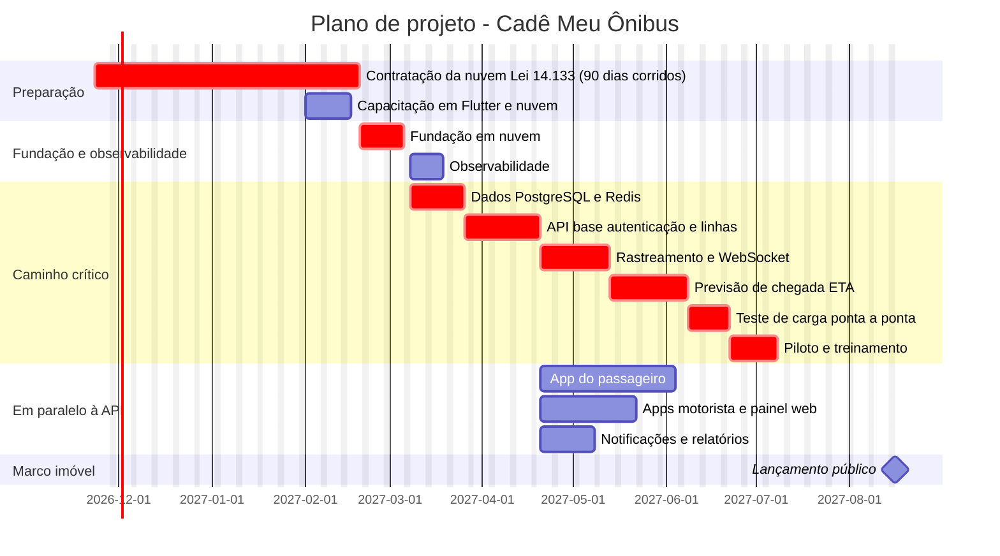

# Etapa 2 — Plano de Projeto: Cadê Meu Ônibus

**Centro Universitário de Ensino Superior do Amazonas — CIESA**
**Disciplina:** Projetos de Sistemas · **Trabalho Individual — Etapa 2**
**Aluno:** [Nome do aluno]

> Toda decisão de arquitetura é um cheque que o projeto assina. Este plano mostra o valor de cada cheque.

Este plano parte da arquitetura da **Etapa 1** (`README.md`): app do passageiro e app do motorista em Flutter, painel web em React, servidor/API em Node.js + NestJS, PostgreSQL + PostGIS, Redis e hospedagem em nuvem. Cada pacote, prazo e custo abaixo aponta para uma decisão da Etapa 1.

## 0. Decisões de partida e premissas

### Decisões da Etapa 1 que originam o plano

| Origem | Decisão |
|---|---|
| **ADR-001** | App móvel multiplataforma (Flutter) para passageiro e motorista, em vez de PWA ou dois apps nativos. |
| **ADR-002** | PostgreSQL + PostGIS para dados cadastrais e Redis para a posição atual dos ônibus, em vez de MongoDB ou só PostgreSQL. |
| **ADR-003** | Hospedagem em nuvem com 2 ou mais instâncias atrás de balanceador, em vez de servidor próprio. |
| **C4 nível 2** | Contêineres: App Passageiro, App Motorista, Painel Web, Servidor/API, PostgreSQL, Redis; todas as setas com TLS. |
| **C4 nível 3** | Componentes da API: autenticação com token de 15 min, linhas e paradas, rastreamento + gateway WebSocket, previsão de chegada (ETA), notificações, relatórios e adaptadores externos. |

### Premissas gerais (valem para todo o documento)

- **P1.** Moeda constante em reais de nov/2026, sem reajuste; US$ 1 = R$ 5,50.
- **P2.** Um dia de trabalho de uma pessoa custa **R$ 700** (salário + encargos + estrutura ≈ R$ 15,4 mil/mês). Cada pacote é conduzido por 1 pessoa-equivalente em tempo integral, exceto a capacitação (4 pessoas).
- **P3.** Durações em **dias úteis**, sem feriados no Gantt. Os feriados nacionais do período somam cerca de uma semana.
- **P4.** Carga de dimensionamento: **5.000 usuários simultâneos** (RNF02) e 99,5% de disponibilidade (RNF05).
- **P5.** A operadora é uma entidade sujeita à **Lei 14.133/2021**: toda contratação relevante leva no mínimo **90 dias corridos**.
- **P6.** Limites da frente, fixados pela gestora: **R$ 450 mil de investimento** e **R$ 120 mil/ano de custeio**. Acima disso, a decisão vai ao Conselho. O custeio pode ser **contingenciado em até 15% sem aviso** (limite efetivo de R$ 102 mil/ano).
- **P7.** Início do desenvolvimento em **01/02/2027**. O processo de contratação da nuvem começa em **23/11/2026**.

---

## 1. Tabela de impacto — seis ângulos de cada decisão

| Dimensão | ADR-001 — Flutter | ADR-002 — PostgreSQL + Redis | ADR-003 — Nuvem com 2+ instâncias |
|---|---|---|---|
| **Escopo** | **Cria:** 4.1 App do passageiro, 4.2 App do motorista, 5.1 capacitação em Flutter, publicação nas lojas. **Elimina:** o segundo app nativo (Kotlin + Swift) e a gambiarra de push do PWA. | **Cria:** 2.1 modelo PostgreSQL/PostGIS, 2.2 cache Redis de posições, 2.3 carga inicial das linhas e paradas. **Elimina:** modelagem de documentos do MongoDB e relatórios sobre dados sem esquema. | **Cria:** 1.1 infraestrutura como código, 1.2 TLS e rede privada, 1.3 backup/restauração, 5.2 capacitação em nuvem, 5.3 observabilidade. **Elimina:** compra de servidores, sala técnica e 90 dias de licitação de bens. |
| **Cronograma** | Depende do contrato OpenAPI da API base para integrar. Roda em paralelo ao rastreamento e à ETA. **Quase crítico** (folga de 2 dias). | Depende da fundação em nuvem (precisa do banco gerenciado). Entra **no caminho crítico**: a API não existe sem dados. | Depende da contratação (90 dias). A contratação entra **no caminho crítico**, pois nada sobe antes dela. |
| **Custo** | Mão de obra: app passageiro 32,5 d ≈ R$ 22,8 mil; cursos de Flutter R$ 6 mil. Operação: ≈ R$ 6 mil/ano (assinatura Apple e manutenção de plugins), absorvida pela equipe de operação. | Mão de obra: 13,7 d ≈ R$ 9,6 mil. Operação: banco e Redis gerenciados dentro dos R$ 54 mil/ano de nuvem. | Implantação de infraestrutura R$ 60 mil (contra R$ 210 mil do servidor próprio). Operação R$ 96 mil/ano (contra R$ 126 mil). Detalhes na seção 2.3. |
| **Riscos** | **Mitiga:** falta de push no iOS (RF07), duas bases de código. **Cria:** equipe sem experiência em Flutter (R1), dependência de plugins. | **Mitiga:** lentidão na posição em tempo real (RNF01) e quebra de integridade (RN03, RN06). **Cria:** divergência entre cache e banco (R2). | **Mitiga:** ponto único de falha (RNF05) e pico de uso (RNF02). **Cria:** atraso na contratação (R3), reajuste cambial (R7), dependência do provedor. |
| **Aquisições** | **Construir** os apps. **Comprar:** contas Apple/Google, serviço de push (FCM/APNs). | **Construir** o modelo de dados. **Comprar:** PostgreSQL e Redis gerenciados no provedor de nuvem. | **Comprar** nuvem por pregão (≥ 90 dias). Dependência do provedor justificada na seção 2.6. |
| **Equipe** | Competência **não existe**: capacitação de 40 h para 2 pessoas. Quem opera depois: dev mobile (manutenção) e suporte N1. | Competência existe em parte (SQL); Redis e PostGIS exigem estudo. Opera: analista de infraestrutura. | Competência de nuvem **não existe**: capacitação de 40 h para 2 pessoas. Opera: analista de infraestrutura (0,25 FTE). |

---

## 2. Entregáveis

### 2.1 Escopo — a EAP

```mermaid
---
title: "EAP — Cadê Meu Ônibus (3 níveis, com pacotes de transição e pacotes eliminados)"
---
flowchart TD
    R["0 Cadê Meu Ônibus<br/>entrega do sistema"]

    R --> P1["1 Fundação em nuvem<br/>ADR-003"]
    R --> P2["2 Dados<br/>ADR-002"]
    R --> P3["3 Servidor / API<br/>C4 nível 3"]
    R --> P4["4 Clientes<br/>ADR-001"]
    R --> P5["5 Transição<br/>capacitação, observabilidade, migração"]
    R -.-> P6["6 Eliminados pelas decisões"]

    P1 --> P11["1.1 Infraestrutura como código<br/>2 instâncias + balanceador"]
    P1 --> P12["1.2 TLS, certificados e rede privada"]
    P1 --> P13["1.3 Backup e restauração"]

    P2 --> P21["2.1 Modelo PostgreSQL + PostGIS"]
    P2 --> P22["2.2 Cache Redis de posições"]

    P3 --> P31["3.1 Autenticação JWT"]
    P3 --> P32["3.2 Linhas e paradas"]
    P3 --> P33["3.3 Rastreamento + gateway WebSocket"]
    P3 --> P34["3.4 Previsão de chegada ETA"]
    P3 --> P35["3.5 Notificações"]
    P3 --> P36["3.6 Relatórios"]

    P4 --> P41["4.1 App do passageiro Flutter"]
    P4 --> P42["4.2 App do motorista Flutter"]
    P4 --> P43["4.3 Painel web React"]

    P5 --> P51["5.1 Capacitação em Flutter"]
    P5 --> P52["5.2 Capacitação em operação na nuvem"]
    P5 --> P53["5.3 Observabilidade"]
    P5 --> P54["5.4 Teste de carga ponta a ponta"]
    P5 --> P55["5.5 Migração dos dados e piloto"]
    P5 --> P56["5.6 Treinamento de motoristas e administradores"]

    P6 -.-> E1["6.1 Compra de servidores e sala técnica<br/>ELIMINADO pelo ADR-003"]
    P6 -.-> E2["6.2 Segundo app nativo Kotlin + Swift<br/>ELIMINADO pelo ADR-001"]

    classDef trans fill:#fff3cd,stroke:#b8860b,color:#000
    classDef elim fill:#f8d7da,stroke:#a94442,color:#000,stroke-dasharray: 5 5
    class P5,P51,P52,P53,P54,P55,P56 trans
    class P6,E1,E2 elim
```



**Legenda:** caixas brancas = pacotes que nascem da arquitetura; amarelo = pacotes de **transição** (o trabalho de chegar até a arquitetura); vermelho tracejado = pacotes que as decisões **eliminam**. Setas tracejadas indicam que o pacote não será executado. Cada pacote de nível 1 cita a decisão da Etapa 1 que o origina.

#### Rastreabilidade dos pacotes

| Pacote | Decisão-origem (Etapa 1) | Requisitos atendidos |
|---|---|---|
| 1.1 Infraestrutura como código | ADR-003 | RNF05, RNF02 |
| 1.2 TLS e rede privada | C4 nível 2 (setas com TLS), seção 2.3.3 | RNF03 |
| 1.3 Backup e restauração | ADR-003 | RNF05 |
| 2.1 Modelo PostgreSQL + PostGIS | ADR-002 | RN03, RN06, RF11, RF12 |
| 2.2 Cache Redis de posições | ADR-002 | RNF01, RNF02 |
| 3.1 Autenticação JWT | C4 nível 3 (Serviço de Autenticação) | RF05, RNF04 |
| 3.2 Linhas e paradas | C4 nível 3 | RF01, RF04, RF06 |
| 3.3 Rastreamento + WebSocket | C4 nível 2 (WSS), C4 nível 3 | RF02, RF09, RF10, RNF01 |
| 3.4 Previsão de chegada (ETA) | C4 nível 3 | RF03, RNF02 |
| 3.5 Notificações | C4 nível 3 (adaptadores externos) | RF07, RF08, RF14 |
| 3.6 Relatórios | C4 nível 3 | RF13 |
| 4.1 App do passageiro | ADR-001 | RF01 a RF08, RNF06, RNF07, RNF08 |
| 4.2 App do motorista | ADR-001 | RF09, RF10 |
| 4.3 Painel web | C4 nível 2 | RF11 a RF14, RNF07 |
| 5.1 Capacitação em Flutter | ADR-001 (competência ausente) | RNF06, RNF07 |
| 5.2 Capacitação em nuvem | ADR-003 (competência ausente) | RNF05 |
| 5.3 Observabilidade | ADR-003 (medir o RNF05) e ADR-002 (medir o RNF01) | RNF01, RNF02, RNF05 |
| 5.4 Teste de carga | ADR-003 e ADR-002 (prova de RNF02) | RNF02 |
| 5.5 Migração e piloto | ADR-002 (carga das linhas e paradas) | RN03, RF01 |
| 5.6 Treinamento | ADR-001 (apps do motorista e do administrador) | RF09, RF10, RF11 |

**Pacotes eliminados:** (6.1) a compra de servidores e a sala técnica deixam de existir com o ADR-003: somem R$ 210 mil de implantação, 90 dias de licitação de bens e o custo de capacidade ociosa fora dos picos. (6.2) o segundo app nativo deixa de existir com o ADR-001, e o esforço do app do passageiro é feito uma vez só.

### 2.2 Cronograma e caminho crítico

#### Dependências impostas pela arquitetura

| Dependência | Por quê |
|---|---|
| Contratação da nuvem → Fundação em nuvem | Sem contrato não há conta nem ambiente (ADR-003). A Lei 14.133 impõe ≥ 90 dias. |
| Capacitação → Fundação e apps | Ninguém na equipe domina nuvem nem Flutter hoje; subir infraestrutura sem saber operá-la cria o risco que o ADR-003 deveria reduzir. |
| Fundação em nuvem → Dados (PostgreSQL + Redis) | O banco e o Redis são gerenciados pelo provedor (ADR-002 sobre ADR-003). |
| Dados → API base (autenticação, linhas e paradas) | A API só persiste e consulta o que o modelo de dados já define. |
| API base → Rastreamento + WebSocket | O gateway usa o token e o cadastro de linhas e viagens. |
| Rastreamento → ETA | A previsão de chegada é calculada sobre as posições no Redis. |
| API base → Apps e painel | Os clientes integram pelo contrato OpenAPI da API base (C4 nível 2). |
| Fundação → Observabilidade → Teste de carga | Teste sem telemetria não prova o RNF02; não se mede o que não está instrumentado. |
| ETA + Observabilidade → Teste de carga | O teste precisa do caminho completo (cliente → API → Redis/banco). |
| Teste de carga → Piloto | Não se coloca motorista e passageiro reais em sistema que não passou no pico de 5.000 usuários. |
| Tudo → Lançamento público | **Marco imóvel**: 16/08/2027, com congelamento de mudanças de 72 h (a partir de 13/08). |



**Legenda:** barras em destaque = caminho crítico; demais barras = trabalho com folga; losango = marco imóvel. Durações em dias úteis; a contratação de 64 dias úteis equivale a cerca de 90 dias corridos.

- **Caminho crítico:** contratação da nuvem → fundação → dados → API base → rastreamento → ETA → teste de carga → piloto → lançamento.
- **Quase crítico:** a capacitação (folga de 3 dias sobre a contratação) e o app do passageiro (folga de 2 dias sobre a ETA). Qualquer atraso neles vira atraso do projeto.
- **Em paralelo:** observabilidade, notificações, relatórios, app do motorista e painel web. Equipes distintas, ligadas pelo contrato OpenAPI.
- **Marco imóvel:** lançamento em 16/08/2027, ligado ao início do semestre letivo. O prazo não se negocia; o escopo, sim: se faltar tempo, saem primeiro 3.5 Notificações (RF07, RF08, RF14) e 3.6 Relatórios (RF13).
- **Previsão:** a cadeia crítica sem a contratação soma **97,3 dias úteis (PERT)** com desvio de **9,6 dias**. Término esperado: **início de julho de 2027**, cerca de uma semana a mais com feriados. Com 95% de confiança (+2σ ≈ 116 dias) o término fica **por volta de 12/08/2027**, perto do congelamento de 13/08. A folga é pequena, e por isso o corte de escopo está definido de antemão.

### 2.3 Custo em três anos

Comparamos as duas alternativas reais do **ADR-003**: **A** (servidor próprio dimensionado para o pico) e **B** (nuvem com 2+ instâncias).

#### Infraestrutura — implantação e operação

| Item | A · Servidor próprio | B · Nuvem |
|---|---|---|
| **Implantação** | **R$ 210 mil**: 3 servidores (2 app + 1 banco) R$ 120 mil; rack, nobreak e climatização R$ 45 mil; link redundante R$ 15 mil; instalação e migração R$ 30 mil | **R$ 60 mil**: apoio externo de nuvem R$ 24 mil; cursos R$ 12 mil; ambiente de homologação e teste de carga (3 meses) R$ 18 mil; lojas e ferramentas R$ 6 mil |
| **Operação/ano** | **R$ 126 mil**: energia, refrigeração e link R$ 36 mil; sysadmin 0,5 FTE R$ 60 mil; garantia e manutenção R$ 18 mil; backup e licenças R$ 12 mil | **R$ 96 mil**: nuvem R$ 54 mil (R$ 4.500/mês: 2 instâncias, PostgreSQL e Redis gerenciados, balanceador, tráfego e backup); analista de infraestrutura 0,25 FTE R$ 30 mil; observabilidade, lojas e backup R$ 12 mil |
| **Total em 3 anos (infra)** | R$ 210 + 3 × 126 = **R$ 588 mil** | R$ 60 + 3 × 96 = **R$ 348 mil** |

**Premissas:** 1 FTE de infraestrutura = R$ 120 mil/ano; nuvem cotada em dólar (P1); servidor próprio sem reposição de hardware em 3 anos; A atende o RNF05 apenas com o link redundante e sem tolerância a falha do site.

#### Frente completa (investimento e custeio)

| Linha | A | B |
|---|---|---|
| Infraestrutura (implantação) | R$ 210 mil | R$ 60 mil |
| Mão de obra dos 12 pacotes principais (187,3 d × R$ 700) | R$ 131 mil | R$ 131 mil |
| Mão de obra extra da capacitação (3 pessoas × 11,3 d × R$ 700) | R$ 24 mil | R$ 24 mil |
| Gerência de projeto (30% de 1 pessoa × 110 d × R$ 700) | R$ 23 mil | R$ 23 mil |
| Reserva de contingência (seção 2.5) | R$ 33 mil | R$ 33 mil |
| Reserva gerencial (10% da base) | R$ 39 mil | R$ 24 mil |
| **Investimento total** | **R$ 460 mil** | **R$ 295 mil** |
| Custeio por ano | R$ 126 mil | R$ 96 mil |
| **Total em 3 anos (investimento + custeio)** | **R$ 838 mil** | **R$ 583 mil** |

Premissa: para ser conservador com B, a mão de obra foi mantida igual nas duas alternativas, ainda que A dispense a capacitação em nuvem.

#### Respeito aos limites da frente (P6)

| Limite | A | B |
|---|---|---|
| Investimento ≤ R$ 450 mil | ❌ R$ 460 mil | ✅ R$ 295 mil |
| Custeio ≤ R$ 120 mil/ano | ❌ R$ 126 mil | ✅ R$ 96 mil |
| Custeio com contingenciamento de 15% (≤ R$ 102 mil) | ❌ | ✅ (folga de R$ 6 mil) |

**Decisão:** B. A alternativa A estoura os dois limites e iria ao Conselho; B cabe nos dois.

**Sensibilidade (o detalhe que derruba planos):** se a nuvem custar 30% mais que o previsto (R$ 70 mil/ano), o custeio de B vai a R$ 112 mil: ainda abaixo do limite de R$ 120 mil, mas **acima dos R$ 102 mil** que sobrariam após um contingenciamento de 15%. Por isso o **R7** (seção 2.5) tem gatilho de custo mensal. Em 3 anos, a nuvem teria de custar **cerca de 2,5 vezes** o previsto (R$ 134 mil/ano) para a alternativa A empatar.

### 2.4 Estimativa dos pacotes (PERT)

`PERT = (O + 4M + P) / 6` · `Desvio = (P − O) / 6` · valores em dias úteis, para 1 pessoa-equivalente por pacote (P2).

| Pacote | O | M | P | PERT (d) | Desvio (d) | Premissa e **cauda pessimista ligada ao risco** |
|---|---|---|---|---|---|---|
| 5.1 + 5.2 Capacitação (Flutter e nuvem) | 8 | 10 | 20 | 11,3 | 2,0 | 2 trilhas de 40 h; cauda: R1, equipe não aprova na avaliação prática |
| 1 Fundação em nuvem | 6 | 10 | 22 | 11,3 | 2,7 | IaC com Terraform; cauda: R3, contrato ou permissões da nuvem atrasam |
| 2 Dados (PostgreSQL, PostGIS e Redis) | 8 | 12 | 26 | 13,7 | 3,0 | Modelo com 10 entidades; cauda: R2, desenho de TTL e consistência do cache |
| 3.1 + 3.2 API base | 10 | 15 | 30 | 16,7 | 3,3 | Contrato OpenAPI fechado antes do código; cauda: mudança de contrato com clientes já integrando |
| 3.3 Rastreamento + WebSocket | 8 | 14 | 35 | 16,5 | 4,5 | Meta de 5 s (RNF01); cauda: R6, conexões WebSocket não escalam no balanceador |
| 3.4 ETA | 8 | 15 | 40 | 18,0 | 5,3 | Cálculo por trecho e velocidade média; cauda: R2, previsão imprecisa exige refazer o algoritmo |
| 3.5 + 3.6 Notificações e relatórios | 8 | 12 | 25 | 13,5 | 2,8 | Push via FCM/APNs; cauda: R4, mudança nas regras dos provedores |
| 4.1 App do passageiro | 20 | 30 | 55 | 32,5 | 5,8 | 12 telas; cauda: R1 (curva de Flutter) e rejeição na loja de aplicativos |
| 4.2 + 4.3 App do motorista e painel web | 15 | 22 | 40 | 23,8 | 4,2 | App com 3 telas + painel CRUD; cauda: R5, ajustes após feedback dos motoristas |
| 5.3 Observabilidade | 5 | 8 | 16 | 8,8 | 1,8 | Métricas, logs e alertas básicos; cauda: ferramenta nova na equipe |
| 5.4 Teste de carga ponta a ponta | 5 | 8 | 20 | 9,5 | 2,5 | 5.000 usuários simultâneos; cauda: R6, reprovação do p95 de 2 s e retrabalho |
| 5.5 + 5.6 Migração, piloto e treinamento | 6 | 10 | 24 | 11,7 | 3,0 | Piloto em 2 linhas; cauda: R5, baixa adesão dos motoristas |
| **Total (esforço)** | **107** | | **353** | **187,3** | | Mão de obra: R$ 75 mil (otimista) · **R$ 131 mil (esperado)** · R$ 247 mil (pessimista) |

**Leitura:** a faixa de custo de mão de obra vai de R$ 75 mil a R$ 247 mil. A cauda pessimista está concentrada em ETA, rastreamento e app do passageiro, que são os pacotes ligados aos riscos arquiteturais R2 e R6 e ao risco de equipe R1.

### 2.5 Riscos

| ID | Risco | Origem | Resposta planejada | Gatilho (condição objetiva) | Reserva |
|---|---|---|---|---|---|
| **R1** | A equipe não domina Flutter nem operação em nuvem | Equipe | **Mitigar:** capacitação de 40 h por trilha (pacotes 5.1 e 5.2) + apoio externo pontual de R$ 24 mil | Avaliação prática (compilar o app e subir a infraestrutura com IaC) não aprovada até 15/02/2027 | Contingência R$ 12 mil (40% × R$ 30 mil) |
| **R2** | Cache serve posição vencida e a ETA fica imprecisa; passageiro perde o ônibus | Arquitetural (ADR-002) | **Mitigar:** TTL de 15 s no Redis, campo `atualizadoEm` na resposta e aviso "posição de há X s" no app | Na homologação, erro da previsão acima de 3 min em mais de 20% das medições | Contingência R$ 6 mil (30% × R$ 20 mil) |
| **R3** | Contratação da nuvem não conclui antes de 19/02/2027 | Projeto | **Evitar/mitigar:** iniciar em 23/11/2026; plano B de adesão a ata de registro de preços já vigente | Sem edital publicado até **31/12/2026** (60 dias antes) | **Gerencial** (a direção decide mover o marco ou cortar escopo) |
| **R4** | Serviço de mapas e rotas muda preço, limite ou API | Arquitetural (C4 nível 1) | **Mitigar:** adaptadores externos isolados (C4 nível 3), cache de geocodificação e alternativa em OpenStreetMap | Custo mensal de mapas acima de R$ 3 mil ou aviso de descontinuação do provedor | Contingência R$ 3,75 mil (25% × R$ 15 mil) |
| **R5** | Motoristas não compartilham o GPS e a posição some do mapa | Projeto | **Mitigar:** tela de viagem com 2 toques, treinamento (5.6) e piloto em 2 linhas antes do lançamento | Menos de 80% das viagens do piloto com posição ativa em 2 semanas seguidas | Contingência R$ 4 mil (40% × R$ 10 mil) |
| **R6** | O pico derruba a API ou o p95 passa de 2 s | Arquitetural (ADR-003) | **Mitigar:** 2+ instâncias, balanceador, Redis para leituras e **teste de carga (5.4)** com 5.000 usuários | p95 acima de 2 s no teste de carga | Contingência R$ 7,5 mil (30% × R$ 25 mil) |
| **R7** | A fatura da nuvem sobe (câmbio ou uso) e o custeio passa do limite efetivo | Arquitetural (ADR-003) | **Aceitar e monitorar:** alertas de custo na nuvem; otimizar instâncias antes de pedir verba | Fatura mensal acima de **R$ 5.000** por 2 meses seguidos (limite efetivo de R$ 102 mil/ano) | **Gerencial** |
| **R8** | Queda do sistema no horário de pico após o lançamento, com repercussão pública | Arquitetural (mitigado) | É o risco que o ADR-003 existe para reduzir (RNF05) | — (risco mitigado pela decisão) | — |

**Reserva de contingência (linha de base):** soma de probabilidade × impacto dos riscos identificados com reserva de contingência: 12 + 6 + 3,75 + 4 + 7,5 = **R$ 33,25 mil ≈ R$ 33 mil**. Fica na linha de base e o gerente do projeto pode usá-la quando o gatilho disparar.

**Reserva gerencial:** **R$ 24 mil (10% da base de B)**. Cobre o que não foi identificado e os riscos R3 e R7. Só a direção libera.

### 2.6 Aquisições

| Item | Construir × comprar | Prazo de contratação | Dependência de fornecedor e custo de sair |
|---|---|---|---|
| **Nuvem** (instâncias, balanceador, PostgreSQL e Redis gerenciados) | **Comprar** por pregão eletrônico (valor global acima do que se contrata sem licitação) | **90 dias corridos** no mínimo (premissa P5); começa em 23/11/2026 | **Alta, justificada:** nenhuma alternativa dá a redundância do RNF05 por menos (seção 2.3). **Sair custa** ≈ 25 dias úteis (reescrever a IaC específica 15 d, migrar os dados 5 d, testar 5 d) ≈ **R$ 17,5 mil** e uma janela de manutenção. O código da aplicação **não muda**: roda em contêineres e usa PostgreSQL e Redis padrão. |
| **Mapas e rotas** | **Comprar** (API) | Contrato pequeno; 30 dias | **Média.** Sair custa ≈ **11 dias úteis (PERT 6/10/20) ≈ R$ 7,7 mil**, só no adaptador externo, mais nova geocodificação das paradas. |
| **Push (FCM/APNs)** | **Comprar** (gratuito) | Sem contratação | **Alta, mas obrigatória:** são as únicas vias de push em Android e iOS. Sair é trocar de canal (e-mail ou SMS), sem reescrever as regras de negócio. |
| **E-mail transacional** | **Comprar** (SaaS) | 30 dias | **Baixa.** Troca por SMTP padrão em ≈ 3 dias. |
| **Apps, API e painel** | **Construir** | — | É o núcleo do negócio; construir mantém o conhecimento dentro da operadora. |
| **Teste de carga** | **Construir** com ferramenta de código aberto (k6) | — | Sem fornecedor; entra na capacitação 5.2. |

**Caminho crítico e aquisições:** a única contratação de prazo longo é a nuvem. Por isso o processo de contratação **começa três meses antes** do desenvolvimento (23/11/2026) e é o primeiro item do caminho crítico.

### 2.7 Recursos humanos

#### Quem faz e quem opera depois

| Pacote | Responsável pela execução | Quem opera depois |
|---|---|---|
| 1 Fundação em nuvem; 5.3 Observabilidade | Analista de infraestrutura/DevOps (0,5 FTE no projeto) | **Analista de infraestrutura (0,25 FTE)**, dono da operação |
| 2 Dados | Desenvolvedor back-end | Analista de infraestrutura (backup, desempenho) |
| 3 Servidor/API | Desenvolvedor back-end e arquiteto | Desenvolvedor back-end (plantão de correção) |
| 4.1, 4.2 Apps Flutter | Desenvolvedor mobile | Desenvolvedor mobile (manutenção e lojas) |
| 4.3 Painel web | Desenvolvedor web | Desenvolvedor web |
| 5.1, 5.2 Capacitação | Gerente do projeto com apoio externo | — |
| 5.4 Teste de carga | Analista de infraestrutura | Repetido a cada grande mudança |
| 5.5, 5.6 Piloto e treinamento | Gerente do projeto e administrador da frota | **Gestor de frota** (administrador) e **suporte N1** (atendimento) |

Equipe do projeto: gerente (30%), arquiteto/tech lead (1), back-end (1), mobile (1), web (1) e infraestrutura (0,5).

#### Competências

| Competência | Existe? | Pacote |
|---|---|---|
| Flutter/Dart | **Não** | 5.1 — 40 h para 2 pessoas, 5 dias úteis de aula + prática; custo R$ 6 mil |
| Operação em nuvem e IaC | **Não** | 5.2 — 40 h para 2 pessoas; custo R$ 6 mil mais apoio externo de R$ 24 mil |
| SQL e modelagem relacional | Sim | — |
| PostGIS e Redis | Parcial | Estudo dentro dos pacotes 2.1 e 2.2 |
| Teste de carga | **Não** | Dentro da capacitação 5.2 (k6) |

A capacitação tem **duração (11 dias úteis), custo (R$ 12 mil de cursos + R$ 24 mil de mão de obra extra) e lugar no cronograma**: entra antes da fundação e dos apps, e tem folga de apenas 3 dias.

#### Lei de Brooks

Se o projeto atrasar, **não vamos adicionar pessoas ao caminho crítico**: quem chega precisa aprender nuvem e a arquitetura, e esse treinamento consome o tempo de quem já sabe. A resposta ao atraso é **cortar escopo** (3.5 e 3.6) ou usar a reserva gerencial, nunca inflar a equipe.

#### Lei de Conway

A arquitetura reflete a comunicação da organização, então desenhamos as equipes a partir dos contêineres do C4 nível 2: **time de clientes** (apps e painel), **time do servidor** (API) e **time de plataforma** (nuvem, dados, observabilidade). A fronteira entre eles é o **contrato OpenAPI** da API base. Se a operadora tivesse um único time, o sistema tenderia a um monólito de código acoplado, e é por isso que o contrato é fechado antes do código dos clientes.

---

## 3. Verificação final

- [x] **EAP** com 3 níveis, pacotes de transição (5.1 a 5.6) e 2 pacotes eliminados (6.1 e 6.2), todos rastreados a uma decisão da Etapa 1.
- [x] **Cronograma** em Gantt (Mermaid), dependências com "por quê", caminho crítico, paralelismo e marco imóvel.
- [x] **Custo** de duas alternativas por implantação e operação em 3 anos, com limites da frente e sensibilidade.
- [x] **PERT** com 3 pontos por pacote principal e cauda ligada a um risco real.
- [x] **Riscos:** 8 riscos com origem, resposta, gatilho e reserva (contingência e gerencial distinguidas).
- [x] **Aquisições:** construir × comprar, prazo da Lei 14.133 e custo de sair de cada fornecedor.
- [x] **Recursos humanos:** quem faz, quem opera, capacitação, Brooks e Conway.

---

## Anexo A — Pacotes de trabalho (modelo da EAP)

```text
ID             : 3.3
Pacote         : Rastreamento + gateway WebSocket
Entrega        : endpoint WSS que publica posições e endpoints REST de viagem, com contrato OpenAPI
Decisão-origem : posição em tempo real no Redis (Etapa 1, ADR-002) e conexão WSS (C4 nível 2)
Responsável    : desenvolvedor back-end
Estimativa     : O=8 M=14 P=35 → PERT 16,5 dias (desvio 4,5)
Depende de     : 3.1/3.2 API base
Habilita       : 3.4 ETA e app do motorista (4.2)
```

```text
ID             : 3.4
Pacote         : Previsão de chegada (ETA)
Entrega        : GET /api/v1/paradas/{id}/previsoes com cálculo sobre as posições do Redis
Decisão-origem : cache de posições (Etapa 1, ADR-002), meta de 2 s (RNF02)
Responsável    : arquiteto / desenvolvedor back-end
Estimativa     : O=8 M=15 P=40 → PERT 18,0 dias (desvio 5,3)
Depende de     : 3.3 Rastreamento
Habilita       : 5.4 Teste de carga
```

```text
ID             : 5.4
Pacote         : Teste de carga ponta a ponta
Entrega        : relatório de carga com p95 e taxa de erro para 5.000 usuários simultâneos
Decisão-origem : nuvem com 2+ instâncias (Etapa 1, ADR-003), RNF02
Responsável    : analista de infraestrutura
Estimativa     : O=5 M=8 P=20 → PERT 9,5 dias (desvio 2,5)
Depende de     : 3.4 ETA e 5.3 Observabilidade
Habilita       : 5.5 Piloto
```

## Anexo B — Registros de risco (modelo)

```text
Risco    : Cache serve posição vencida e a ETA fica imprecisa
Origem   : arquitetural
Resposta : mitigar — TTL de 15 s e campo atualizadoEm, com aviso no app
Gatilho  : erro da previsão acima de 3 min em mais de 20% das medições na homologação
Reserva  : contingência (linha de base) — R$ 6 mil
```

```text
Risco    : Contratação da nuvem não conclui antes de 19/02/2027
Origem   : projeto
Resposta : evitar/mitigar — iniciar em 23/11/2026; plano B por ata de registro de preços
Gatilho  : sem edital publicado até 31/12/2026
Reserva  : gerencial (direção)
```
